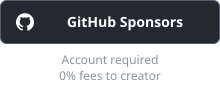
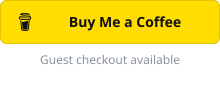

# Adam Chesters community defaults

Shared repository funding links for projects by Adam Chesters.

## Feedback and support

  
  
  
  
  

<h3 align="center">Support</h3>

I love making things to have fun, share fun, and make life a lil better. If you got value out of one of them, feel free to buy us a coffee. Or a house. Push comes to shove, I prefer Aston Martin. Supporters get golden crowns on the Discord / tags on the subreddit!

  
  

